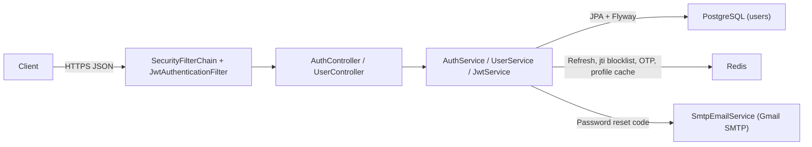

# IAM Service

- **Purpose:** Set up, run, test, and navigate the Identity and Access Management (IAM) RESTful API service built with Spring Boot, Spring Security, PostgreSQL, Flyway, and Redis.
- **For:** Backend engineers running, testing, and extending the IAM service.
- **Date:** 2026-11-26

## Contents

- [Summary](#summary)
- [Architecture and Data Flow](#architecture-and-data-flow)
- [Prerequisites and Local Setup](#prerequisites-and-local-setup)
- [API Endpoints](#api-endpoints)
- [Configuration Reference](#configuration-reference)
- [Feature Documentation](#feature-documentation)

## Summary

IAM Service is a Java 21 Spring Boot 4 application providing stateless authentication and user-profile management over HTTPS. It stores user accounts in PostgreSQL (versioned with Flyway SQL migrations) and stores refresh tokens, logout blocklists, password-reset codes, and profile caches in Redis.

## Architecture and Data Flow

The codebase follows a three-layer layout:

- **Controllers (`app/src/main/java/org/IAM/controllers/`):** Receive HTTP JSON requests, trigger Jakarta Validation on Java `record` Data Transfer Objects (DTOs), and return HTTP responses.
- **Services (`app/src/main/java/org/IAM/services/`):** Enforce authentication, BCrypt password hashing (`DelegatingPasswordEncoder`), `HS256` JSON Web Token (JWT) signing, Redis token/cache operations, and Gmail Simple Mail Transfer Protocol (SMTP) delivery.
- **Repositories (`app/src/main/java/org/IAM/repositories/`):** Map the `User` entity to the PostgreSQL `users` table through Spring Data Java Persistence API (JPA).
- **Security and errors (`app/src/main/java/org/IAM/config/`, `exceptions/`):** Configure a stateless `SecurityFilterChain`, validate Bearer JWTs and Redis `jti` blocklists in `JwtAuthenticationFilter`, and map errors to JSON `{"error": "..."}` responses in `GlobalExceptionHandler`.

The diagram below shows incoming HTTPS requests passing through `SecurityFilterChain` and `JwtAuthenticationFilter` into `AuthController` and `UserController`. Service classes read and write persistent user data in PostgreSQL and ephemeral token, blocklist, OTP, and profile-cache state in Redis, while sending password-reset emails over SMTP.



## Prerequisites and Local Setup

### Requirements

- **Java:** JDK 21 (Gradle toolchain auto-resolves Java 21 if needed).
- **Docker:** Docker Engine and Docker Compose plugin for PostgreSQL 16 and Redis 7.
- **Gmail SMTP (optional for Forgot Password):** A Google account with 2-Step Verification enabled and a 16-character Google App Password.

### Run locally

1. **Create your local environment file:** Copy the template and fill in your values (keep `.env` out of Git):
   ```bash
   cp .env.example .env
   ```
2. **Start PostgreSQL and Redis:**
   ```bash
   docker compose up -d
   ```
3. **Run the Spring Boot application:** Gradle loads `.env` automatically for `bootRun`, and Flyway applies `V1__create_users_table.sql` on startup:
   ```bash
   ./gradlew bootRun
   ```
4. **Run the test suite:** Executes all 44 unit and MockMvc security tests without requiring live containers:
   ```bash
   ./gradlew test
   ```
5. **Stop backing containers:**
   ```bash
   docker compose down
   ```

## API Endpoints

All protected endpoints require an `Authorization: Bearer <accessToken>` header. Identity for `/api/v1/users/me` routes comes exclusively from the signed JWT `sub` claim.

### Authentication (`/api/v1/auth`)

- **`POST /api/v1/auth/register` (public):** Creates a new user with a random `UUID`, unique normalized `email`, and `{bcrypt}` password hash. Returns `201 Created` (`{"success": true}`), `400 Bad Request` on validation failure, or `409 Conflict` on duplicate email.
- **`POST /api/v1/auth/login` (public):** Verifies `email` and `password` via `DelegatingPasswordEncoder.matches`. Returns `200 OK` with a 15-minute `HS256` `accessToken` and 3-hour Redis `refreshToken`, or generic `401 Unauthorized` (`{"error": "Invalid email or password"}`).
- **`POST /api/v1/auth/refresh` (public):** Validates `refreshToken` in Redis (`refresh:<tokenId>`) and returns `200 OK` with a new 15-minute `accessToken`, or `401 Unauthorized` if expired or revoked.
- **`POST /api/v1/auth/logout` (authenticated):** Blocklists the caller's access JWT `jti` in Redis for its remaining lifetime, deletes `refresh:<tokenId>` only after verifying caller ownership, and returns `200 OK` (`{"success": true}`).
- **`POST /api/v1/auth/forgot-password` (public):** Generates a 6-digit code in Redis (`10m` TTL) and emails it if the address exists. Always returns `200 OK` (`{"success": true}`) to limit account enumeration.
- **`POST /api/v1/auth/reset-password` (public):** Verifies the 6-digit code in Redis (maximum 5 failed attempts, single-use deletion), updates the `{bcrypt}` password hash in PostgreSQL, and returns `200 OK` (`{"success": true}`) or `400 Bad Request`.

### User Profile and Password (`/api/v1/users`)

- **`GET /api/v1/users/me` (authenticated):** Returns the caller's profile using a Redis cache-aside lookup (`profile:<userId>`, 10-minute TTL) backed by PostgreSQL.
- **`PUT /api/v1/users/me` (authenticated):** Updates validated profile fields (`fullName`, `phone`, `address`, `dateOfBirth`, `avatarUrl`) in PostgreSQL and deletes `profile:<userId>` from Redis. `email` and `password` are not editable here.
- **`PUT /api/v1/users/me/password` (authenticated):** Verifies `currentPassword` (`401` if wrong), rejects reuse if `newPassword` matches `currentPassword` (`400`), saves the new `{bcrypt}` hash, and blocklists the current access JWT `jti` in Redis.

## Configuration Reference

Environment variables read by `app/src/main/resources/application.properties` and `docker-compose.yml` (defaults live in `.env.example`):

- **PostgreSQL:** `POSTGRES_DB`, `DB_PORT`, `DB_URL`, `DB_USERNAME`, `DB_PASSWORD`.
- **Redis:** `REDIS_HOST`, `REDIS_PORT`.
- **JWT:** `JWT_SECRET` (minimum 32 bytes for `HS256`; replace before deploying).
- **Gmail SMTP:** `MAIL_HOST`, `MAIL_PORT`, `MAIL_USERNAME`, `MAIL_PASSWORD` (Google App Password), `MAIL_FROM`, `MAIL_SMTP_AUTH`, `MAIL_SMTP_STARTTLS`.

## Feature Documentation

Detailed architecture notes for each feature live under `docs/`:

- [User Registration Architecture](docs/register.md)
- [User Login Architecture](docs/login.md)
- [User Logout Architecture](docs/logout.md)
- [User Profile Architecture](docs/profile.md)
- [Change Password Architecture](docs/change-password.md)
- [Forgot Password Architecture](docs/forgot-password.md)
- [DTO and Request Validation Conventions](docs/dto-validation.md)
- [Database Migrations and Local Docker Architecture](docs/migrations-and-docker.md)
