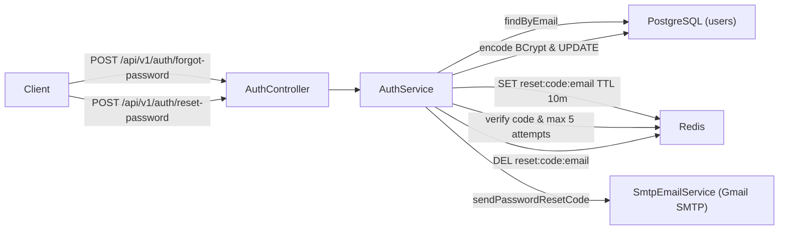

# Forgot Password Architecture

- **Purpose:** Define the implementation architecture for requesting and completing a password reset using email verification codes and Redis in the Identity and Access Management (IAM) service.
- **For:** Backend engineers implementing and reviewing the forgot-password feature.
- **Date:** 2026-11-26

## Summary

The forgot-password feature exposes two unauthenticated endpoints over HTTPS: `POST /api/v1/auth/forgot-password` and `POST /api/v1/auth/reset-password`. Requesting a reset generates a cryptographically random 6-digit code stored in Redis with a 10-minute Time-To-Live (TTL) and emails it through Spring Mail (`JavaMailSender`) over Gmail SMTP. Confirming the reset verifies the code (enforcing a maximum of 5 failed attempts), updates the BCrypt password hash in PostgreSQL, and deletes the Redis code immediately so it cannot be replayed.

## System Architecture

### What each component is responsible for

- **Controller layer (`AuthController`):** Exposes `POST /api/v1/auth/forgot-password` and `POST /api/v1/auth/reset-password`, validates request Data Transfer Objects (DTOs), and returns HTTP `200 OK` with `{"success": true}`.
- **Service layer (`AuthService`):** Coordinates email lookup, 6-digit code generation (`SecureRandom`), Redis storage/verification, email dispatch, and BCrypt password updates.
- **Reset code store (`PasswordResetStoreService`):** Manages `reset:code:<email>` (`10m` TTL) and `reset:attempts:<email>` (invalidates the code after 5 wrong guesses) in Redis.
- **Email layer (`EmailService`, `SmtpEmailService`):** Sends the reset email via `JavaMailSender` using SMTP settings from `application.properties` and environment variables (configured for Gmail SMTP with STARTTLS on port `587`).
- **Repository layer (`UserRepository`):** Looks up the `User` row by normalized `email` and saves the updated `{bcrypt}` password hash.

### How a password reset flows

The diagram below shows a client requesting a reset code at `POST /api/v1/auth/forgot-password`, which stores a 10-minute 6-digit code in Redis and emails it via `SmtpEmailService`. The client then submits the email, code, and new password to `POST /api/v1/auth/reset-password`, which verifies the code in Redis, updates the BCrypt hash in PostgreSQL, and deletes the code.

## Data Model

### Redis keys and TTLs

- **Reset code:** Key `reset:code:<normalizedEmail>` (`String`), value `<6-digit code>`, TTL `600` seconds (10 minutes). Deleted immediately after a successful reset or after 5 failed verification attempts.
- **Attempt counter:** Key `reset:attempts:<normalizedEmail>` (`String` integer counter), TTL `600` seconds (10 minutes). Incremented on each mismatched code; when attempts reach `5`, both keys are deleted so the user must request a new code.

## API Design

### Request reset endpoint

- **Method and path:** `POST /api/v1/auth/forgot-password` (permitted unauthenticated).
- **Request DTO (`ForgotPasswordRequest`):** JSON containing `email` (`@NotBlank`, `@Email`).
- **Success response (`200 OK`):** JSON body `{"success": true}` whether or not the email exists in PostgreSQL, preventing account enumeration.

### Confirm reset endpoint

- **Method and path:** `POST /api/v1/auth/reset-password` (permitted unauthenticated).
- **Request DTO (`ResetPasswordRequest`):** JSON containing `email` (`@NotBlank`, `@Email`), `code` (`@NotBlank`, 6 digits), and `newPassword` (`@NotBlank`, `@Size(min = 8)`).
- **Success response (`200 OK`):** JSON body `{"success": true}`.

### Error handling

- **Invalid, expired, or locked-out code (`400 Bad Request`):** Returns `{"error": "Invalid or expired reset code"}`.
- **Validation failure (`400 Bad Request`):** Handled by `GlobalExceptionHandler`.

## Security Model

- **Enumeration prevention:** `forgot-password` returns identical `200 OK` responses for registered and unregistered emails.
- **Brute-force protection:** A 6-digit code has 1,000,000 combinations, so `PasswordResetStoreService` enforces a 10-minute TTL and invalidates the code after 5 wrong attempts.
- **Single-use enforcement:** Reset codes are deleted from Redis immediately upon successful password update.
- **SMTP credentials:** Gmail SMTP requires 2-Step Verification and a 16-character Google App Password injected via `MAIL_USERNAME` and `MAIL_PASSWORD` environment variables (never committed to Git).
