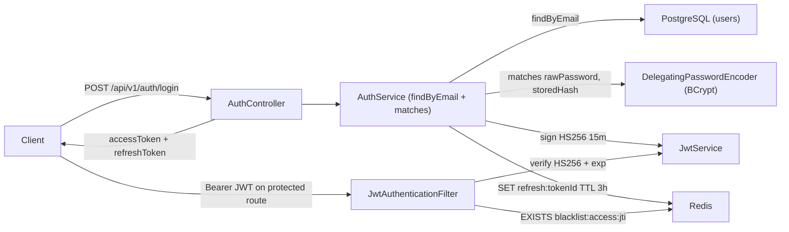

# User Login Architecture

- **Purpose:** Define the implementation architecture for authenticating existing user accounts, issuing JSON Web Tokens (JWTs), refreshing sessions, and validating access tokens in the Identity and Access Management (IAM) service.
- **For:** Backend engineers implementing and reviewing the login and JWT authentication feature.
- **Date:** 2026-11-25

## Summary

The login feature exposes `POST /api/v1/auth/login` and `POST /api/v1/auth/refresh` over HTTPS. Login verifies `email` and `password` directly in `AuthService` via `UserRepository.findByEmail` and `DelegatingPasswordEncoder.matches`, issues a 15-minute `HS256` access JWT plus a 3-hour refresh token stored in Redis, and protects all non-auth routes with a JWT filter that checks signatures, expiry, and a Redis `jti` blocklist.

## System Architecture

### What each component is responsible for

The login and token flow follows the three-layer layout matching `note.md`:

- **Controller layer (`AuthController`):** Exposes `POST /api/v1/auth/login` and `POST /api/v1/auth/refresh`, validates request Data Transfer Objects (DTOs), and returns token responses.
- **Service layer (`AuthService`):** Normalizes `email`, looks up the user via `UserRepository.findByEmail`, verifies the raw password via `DelegatingPasswordEncoder.matches`, and coordinates token creation and refresh. Direct lookup keeps control flow explicit and unit-testable; future account-state checks (disabled, locked, unverified) are enforced explicitly in `AuthService`.
- **JWT service (`JwtService`):** Signs and verifies `HS256` access JWTs carrying `sub` (`userID`), `jti` (unique token UUID), `iat`, and `exp` (15-minute lifetime).
- **Redis token store (`TokenStoreService`):** Stores active refresh tokens (`refresh:<tokenId> -> userId`, 3-hour Time-To-Live (TTL)) and checks/writes revoked access token IDs (`blacklist:access:<jti> -> "revoked"`, TTL equal to remaining access token lifetime, at most 15 minutes).
- **Security filter (`JwtAuthenticationFilter`):** Intercepts protected requests, validates the `Authorization: Bearer <token>` signature and expiry, rejects any token whose `jti` exists in Redis, and populates Spring Security's `SecurityContext`.
- **Repository layer (`UserRepository`):** Looks up the `User` row by normalized `email` using PostgreSQL's unique B-tree index (`O(log N)`).

### How login, refresh, and protected requests flow

The diagram below shows a client authenticating through `AuthController` and `AuthService` against PostgreSQL and `DelegatingPasswordEncoder`, storing the 3-hour refresh token in Redis, and receiving a 15-minute `HS256` access JWT. Subsequent requests to protected routes pass through `JwtAuthenticationFilter`, which verifies the JWT signature and checks the Redis `jti` blocklist.



## Data Model

### Stored password structure

`User.password` stores a one-way salted hash generated at registration rather than encrypted plaintext:

```text
{bcrypt}$2a$10$<22-char random salt><31-char hash output>
```

- **`{bcrypt}` prefix:** Lets `DelegatingPasswordEncoder` select `BCryptPasswordEncoder` from its encoder map in `O(1)` time.
- **Cost factor (`10`):** Runs $2^{10}$ (1024) BCrypt rounds so hashing at registration and verification at login perform the same intentionally slow work (`O(1)` relative to user count).
- **Random salt (22 characters):** Ensures identical passwords across accounts produce distinct hashes.

### Redis keys and TTLs

- **Active refresh token:** Key `refresh:<tokenId>` (`String`), value `<userId>` (`UUID` string), TTL `10,800` seconds (3 hours). Deleted on logout; expires automatically after 3 hours.
- **Revoked access token blocklist:** Key `blacklist:access:<jti>` (`String`), value `"revoked"`, TTL equal to `exp - now` (at most `900` seconds / 15 minutes). Written on logout so a stolen access token is rejected immediately before its own `exp` timestamp passes.

### Verification sequence

1. **Normalize email:** Trim and lowercase the incoming `email` to match the stored value.
2. **Lookup user:** Query PostgreSQL by `email` via the unique B-tree index (`O(log N)`).
3. **Re-hash and compare:** Pass `(rawPassword, storedHash)` to `DelegatingPasswordEncoder.matches`. `BCryptPasswordEncoder` extracts the salt and cost factor from `storedHash`, re-hashes `rawPassword` with that salt, and runs a constant-time byte comparison. Stored passwords are never decrypted.
4. **Issue tokens:** Generate a 15-minute `HS256` access JWT (`sub`, `jti`, `iat`, `exp`) and a random refresh token saved in Redis with a 3-hour TTL.

## API Design

### Login endpoint

- **Method and path:** `POST /api/v1/auth/login` (permitted unauthenticated).
- **Request DTO (`LoginRequest`):** JSON containing `email` and `password`.
- **Success response (`200 OK`):** JSON containing `accessToken`, `refreshToken`, `tokenType` (`"Bearer"`), and `expiresIn` (`900`).

### Refresh endpoint

- **Method and path:** `POST /api/v1/auth/refresh` (permitted unauthenticated).
- **Request DTO (`RefreshRequest`):** JSON containing `refreshToken`.
- **Success response (`200 OK`):** JSON containing a newly signed 15-minute `accessToken`, the `refreshToken`, `tokenType` (`"Bearer"`), and `expiresIn` (`900`).

### Error handling

- **Invalid credentials (`401 Unauthorized`):** Both missing email and wrong password return HTTP `401 Unauthorized` with `{"error": "Invalid email or password"}`. Returning a single generic message follows Open Worldwide Application Security Project (OWASP) guidelines to limit account enumeration.
- **Invalid or expired refresh token (`401 Unauthorized`):** Missing or expired `refresh:<tokenId>` in Redis returns HTTP `401 Unauthorized`.
- **Invalid input (`400 Bad Request`):** Handled by `GlobalExceptionHandler` when request fields fail validation.

## Security Model

### Password and token security

- **One-way hashing:** Plaintext passwords are never stored or recovered; a database leak exposes only salted BCrypt hashes.
- **Constant-time comparison:** `BCryptPasswordEncoder.matches` compares hash bytes in constant time to prevent byte-by-byte timing leaks.
- **Account enumeration mitigation:** Login returns a single generic `401 Unauthorized` error (`"Invalid email or password"`) for both missing emails and wrong passwords.
- **JWT signing and revocation:** Access JWTs use `HS256` with a short 15-minute expiry and unique `jti` claims so logout revokes only the logged-out token without affecting other devices.

### Transport and access control

- **Transport:** Login, refresh, and authenticated API requests travel over HTTPS to protect raw credentials and bearer tokens in transit.
- **Access control:** `SecurityFilterChain` permits unauthenticated `POST /api/v1/auth/register`, `POST /api/v1/auth/login`, and `POST /api/v1/auth/refresh`, and requires a valid non-blocklisted JWT on all other endpoints.
