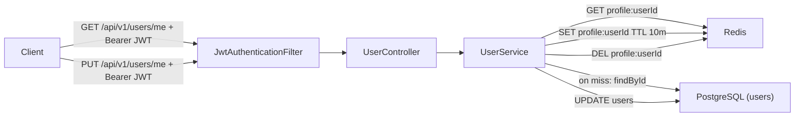

# User Profile Architecture

- **Purpose:** Define the implementation architecture for viewing and updating an authenticated user's profile with Redis cache-aside in the Identity and Access Management (IAM) service.
- **For:** Backend engineers implementing and reviewing the profile feature.
- **Date:** 2026-11-26

## Summary

The profile feature exposes `GET /api/v1/users/me` and `PUT /api/v1/users/me` over HTTPS. Both endpoints derive the target `userId` exclusively from the authenticated JSON Web Token (JWT) in Spring Security's `SecurityContext` to prevent Insecure Direct Object Reference (IDOR). Reads use a Redis cache-aside key (`profile:<userId>`, 10-minute TTL), and updates delete that key after writing to PostgreSQL.

## System Architecture

### What each component is responsible for

- **Security filter (`JwtAuthenticationFilter`):** Validates the `Authorization: Bearer <accessToken>` header and places the authenticated `UUID userId` into `SecurityContext`.
- **Controller layer (`UserController`):** Exposes `GET /api/v1/users/me` and `PUT /api/v1/users/me`, reads `userId` from `Authentication.getPrincipal()`, validates `UpdateProfileRequest`, and returns `ProfileResponse`.
- **Service layer (`UserService`):** Coordinates cache-aside reads (`ProfileCacheService` -> `UserRepository`) and write-then-evict updates (`UserRepository.save` -> `ProfileCacheService.evict`).
- **Cache layer (`ProfileCacheService`):** Serializes and reads `ProfileResponse` JSON in Redis under `profile:<userId>` with a 10-minute Time-To-Live (TTL), and deletes the key on profile updates.
- **Repository layer (`UserRepository`):** Reads and updates the `User` row in PostgreSQL by primary key `userID`.

### How profile read and update requests flow

The diagram below shows `GET /api/v1/users/me` checking Redis (`profile:<userId>`) before falling back to PostgreSQL and populating the cache. `PUT /api/v1/users/me` validates input, updates PostgreSQL, and deletes `profile:<userId>` from Redis so the next read fetches fresh data.

## Data Model

### Profile columns on `users`

Profile fields are stored as nullable columns on `app/src/main/java/org/IAM/repositories/user/User.java` so registration stays unchanged while profile data requires no extra table join:

- **fullName:** Nullable `String` (up to 100 characters).
- **phone:** Nullable `String` (up to 20 characters).
- **address:** Nullable `String` (up to 255 characters).
- **dateOfBirth:** Nullable `LocalDate`.
- **avatarUrl:** Nullable `String` (up to 500 characters).

### Redis cache key

- **Key and value:** `profile:<userId>` (`String`) -> JSON-serialized `ProfileResponse`.
- **TTL:** `600` seconds (10 minutes).
- **Invalidation:** Deleted immediately (`DEL profile:<userId>`) after `UserRepository.save` succeeds in `updateProfile`. Deleting instead of overwriting avoids out-of-order cache writes under concurrent updates.

## API Design

### Get Profile endpoint

- **Method and path:** `GET /api/v1/users/me` (requires valid `Authorization: Bearer <accessToken>`).
- **Success response (`200 OK`, `ProfileResponse`):** JSON containing `userId`, `username`, `email`, `fullName`, `phone`, `address`, `dateOfBirth`, `avatarUrl`, and `createdDate`.

### Update Profile endpoint

- **Method and path:** `PUT /api/v1/users/me` (requires valid `Authorization: Bearer <accessToken>`).
- **Request DTO (`UpdateProfileRequest`):** JSON containing `fullName`, `phone`, `address`, `dateOfBirth` (`@Past`), and `avatarUrl` with length and format validation. `email` and `password` are excluded so login credentials cannot be modified through profile updates.
- **Success response (`200 OK`, `ProfileResponse`):** Returns the updated profile fields.

### Error handling

- **Unauthenticated (`401 Unauthorized`):** Missing, invalid, or blocklisted JWT rejected by `JwtAuthenticationFilter` / `SecurityConfig`.
- **Validation failure (`400 Bad Request`):** Handled by `GlobalExceptionHandler`.
- **User not found (`404 Not Found`):** Handled by `GlobalExceptionHandler` if the token's `userId` no longer exists in PostgreSQL.

## Security Model

- **IDOR prevention:** The server never accepts a `userId` path or body parameter for profile access; `userId` comes solely from the signed JWT `sub` claim in `SecurityContext`.
- **Protected identity fields:** `email`, `password`, `userID`, and `createdDate` are excluded from `UpdateProfileRequest` so clients cannot alter login identity or audit metadata.
